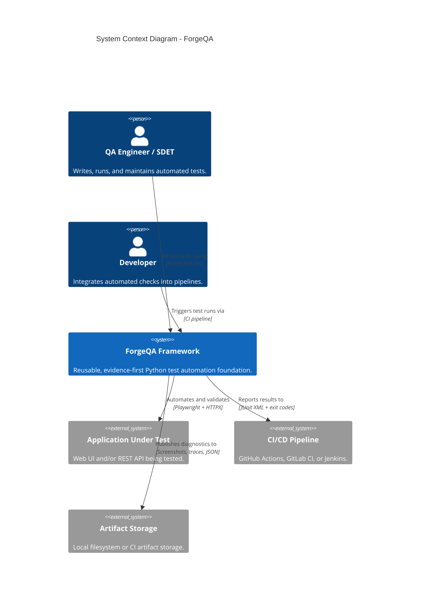
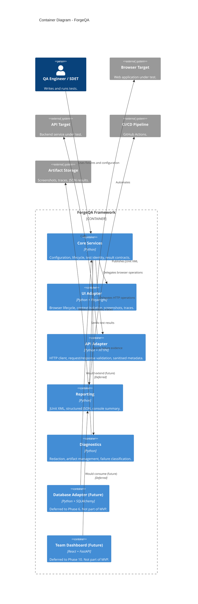

# ForgeQA - Architecture

> **Project Status: Pre-alpha**
> **Version**: 0.1.0
> **Last Updated**: 2026-10-27
> **Owner**: Solo Developer

---

## 1. System Context (C4 Level 1)

> **Purpose**: This diagram shows the ForgeQA system in the context of its external actors and systems. It answers: "Who uses ForgeQA, and what external systems does it interact with?"

### 1.1 Context Diagram Key

| Element | Type | Description | MVP Status |
| :--- | :--- | :--- | :--- |
| **QA Engineer / SDET** | Person | Primary user. Writes and maintains tests. | ✅ MVP |
| **Developer** | Person | Secondary user. Integrates tests into CI. | ✅ MVP |
| **ForgeQA Framework** | System | The reusable test automation foundation. | ✅ MVP |
| **Browser Target** | External System | The web application being tested. | ✅ MVP |
| **API Target** | External System | The backend service being tested. | ✅ MVP |
| **CI/CD Pipeline** | External System | Runs the test suite automatically. | ✅ MVP |
| **Artifact Storage** | External System | Stores screenshots, traces, and results. | ✅ MVP |

---

## 2. Container Diagram (C4 Level 2)

> **Purpose**: This diagram shows the internal containers (modules) of ForgeQA and their dependencies. It answers: "How is ForgeQA structured internally, and what are the responsibilities of each container?"

### 2.1 Container Responsibilities

| Container | Responsibility | Dependencies | MVP Status |
| :--- | :--- | :--- | :--- |
| **Core Services** | Configuration loading, Pytest lifecycle, test identity, result contracts. | Pydantic, Pytest. | ✅ MVP |
| **UI Adapter** | Playwright integration: browser launch, context isolation, screenshots, traces. | Playwright. | ✅ MVP |
| **API Adapter** | HTTPX integration: HTTP client, request/response validation, sanitised metadata. | HTTPX. | ✅ MVP |
| **Reporting** | JUnit XML generation, structured JSON output, console summary. | Core Services. | ✅ MVP |
| **Diagnostics** | Redaction, artifact management, failure classification. | Core Services. | ✅ MVP |
| **Database Adapter** | SQLAlchemy integration for database validation. | SQLAlchemy, Psycopg. | ❌ Deferred (Phase 6) |
| **Team Dashboard** | Shared test history, collaboration, dashboards. | React, FastAPI, PostgreSQL. | ❌ Deferred (Phase 10) |

### 2.2 Dependency Rules

> **Critical**: These rules ensure that the core remains independent of optional adapters.

| Rule | Description |
| :--- | :--- |
| **Core does not import Adapters** | The Core Services container must not import from `adapters.ui` or `adapters.api`. Adapters implement interfaces defined in Core. |
| **Adapters are optional** | Installing `forgeqa` (core) does not install Playwright or HTTPX. Users install `forgeqa[ui]` or `forgeqa[api]` as needed. |
| **Reporting consumes Core results** | Reporting depends on the result contracts defined in Core, not on adapter internals. |
| **Diagnostics are adapter-agnostic** | Diagnostics capture evidence from any adapter via a common interface. |

---

## 3. System Boundary

> **Purpose**: Clearly define what is **inside** ForgeQA (owned and maintained by this project) versus what is **outside** (external dependencies).

| Inside ForgeQA (Owned) | Outside ForgeQA (External) |
| :--- | :--- |
| Core Services (config, lifecycle, contracts) | Python runtime |
| UI Adapter (Playwright integration) | Playwright library |
| API Adapter (HTTPX integration) | HTTPX library |
| Reporting (JUnit XML, JSON) | Pytest |
| Diagnostics (redaction, artifacts) | Pydantic |
| CLI (Phase 2) | GitHub Actions (CI platform) |
| | Browser binaries (Chromium, Firefox, WebKit) |
| | Artifact storage (local filesystem, CI artifacts) |

---

## 4. Deferred Components (Out of MVP Scope)

> These components are explicitly **not** part of Phase 1. They are shown in the diagrams as future extensions to prevent scope creep.

| Component | Deferred To | Rationale | Reconsideration Trigger |
| :--- | :--- | :--- | :--- |
| **Database Adapter** | Phase 6 | Requires validated user workflows; not all users need database testing. | 3+ users request database validation. |
| **Team Dashboard** | Phase 10 | Requires evidence that CI artifacts alone are insufficient for team collaboration. | 2+ design partners request shared history. |
| **CLI Project Scaffolding** | Phase 2 | Not essential for the first successful workflow. Users can copy the reference project structure. | 3+ design partners request it. |
| **Allure Reporting** | Phase 3 | JUnit XML + JSON is sufficient for MVP; Allure is an optional enhancement. | 3+ users request Allure. |
| **Selenium Adapter** | Phase 7 | Playwright covers the initial use case; Selenium adds maintenance burden. | A concrete user requirement justifies it. |
| **Appium Adapter** | Phase 7 | Mobile automation requires additional infrastructure. | A concrete user requirement justifies it. |
| **Distributed Execution** | Phase 4+ | Not needed for initial adoption. | Measured performance requirements justify it. |
| **AI Failure Analysis** | Phase 9+ | Requires validated problem, measurable benefit, and suitable data controls. | Deterministic analytics prove insufficient. |

---

## 5. Public API Design Principles

> These principles guide how ForgeQA exposes its functionality to test authors. They will be formalised in WBS 0.4.4.

| Principle | Description |
| :--- | :--- |
| **Pytest-native** | Integrate with established Pytest fixtures, markers, and lifecycle hooks. Do not build a competing test runner. |
| **Explicit over magical** | A test author should be able to understand where configuration and browser/client objects come from. |
| **Typed contracts** | Use type hints and validated configuration models where they improve correctness. |
| **Optional integrations** | Using an API test should not require installing a browser or dashboard. |
| **Evidence by design** | Diagnostics must be linked to the test execution that produced them. |
| **Secure by default** | Redact sensitive values before emitting logs or artifacts. |
| **Stable public surface** | Distinguish supported public imports from internal implementation modules. |
| **Failure transparency** | Retries and reporting must not silently turn an unsuccessful test into a successful one. |

---

## 6. Architecture Decision Records (ADRs)

> The following ADRs document the key architectural decisions that underpin this diagram. They will be created in WBS 0.4.7.

| ADR ID | Title | Status |
| :--- | :--- | :--- |
| **ADR-001** | Python and Pytest as the core stack | Proposed |
| **ADR-002** | `src/` layout with Hatchling for packaging | Proposed |
| **ADR-003** | Adapter/Protocol boundaries for optional integrations | Proposed |
| **ADR-004** | Versioned JSON and JUnit XML for reporting | Proposed |

---

## 7. Technology Stack (MVP)

> The following technologies are selected for the MVP (Phase 1). Optional technologies are marked as deferred.

| Layer | Technology | Purpose | MVP Status |
| :--- | :--- | :--- | :--- |
| **Language** | Python 3.11+ | Core framework and test authoring. | ✅ MVP |
| **Test Runner** | Pytest | Test discovery, fixtures, markers, execution. | ✅ MVP |
| **Configuration** | Pydantic Settings | Validated configuration and environment profiles. | ✅ MVP |
| **UI Automation** | Playwright | Browser lifecycle, context isolation, screenshots, traces. | ✅ MVP |
| **API Automation** | HTTPX | HTTP client, request/response validation. | ✅ MVP |
| **Reporting** | JUnit XML + Pydantic JSON | CI integration and structured results. | ✅ MVP |
| **CI/CD** | GitHub Actions | Automated test execution and artifact publication. | ✅ MVP |
| **Package Management** | uv + Hatchling | Dependency resolution, build backend. | ✅ MVP |
| **Code Quality** | Ruff + MyPy | Linting, formatting, type checking. | ✅ MVP |
| **Documentation** | MkDocs Material | Long-term documentation site. | Deferred (Phase 2) |
| **Database Validation** | SQLAlchemy + Psycopg | Optional database testing. | Deferred (Phase 6) |
| **Team Dashboard** | React + FastAPI + PostgreSQL | Shared test history, collaboration. | Deferred (Phase 10) |

---

## 8. Document History

| Version | Date | Author | Changes |
| :--- | :--- | :--- | :--- |
| 0.1.0 | 2026-10-27 | Solo Dev | Initial context and container diagrams created using Mermaid.js. |
